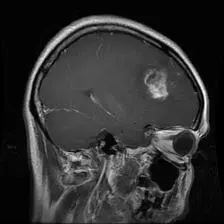
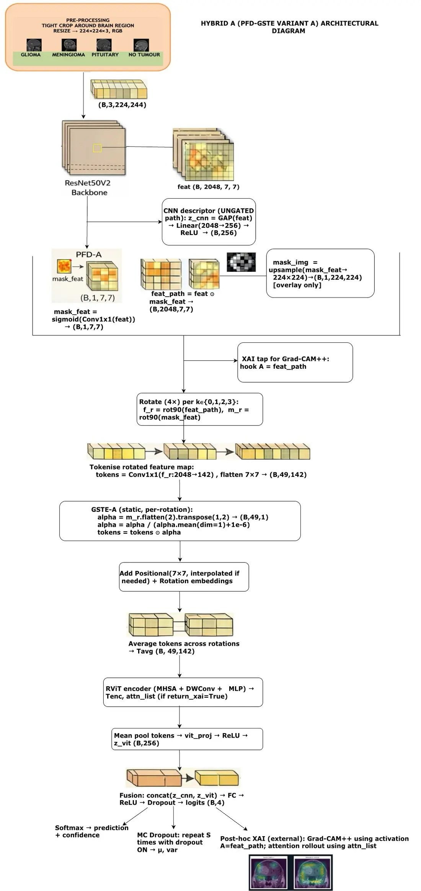
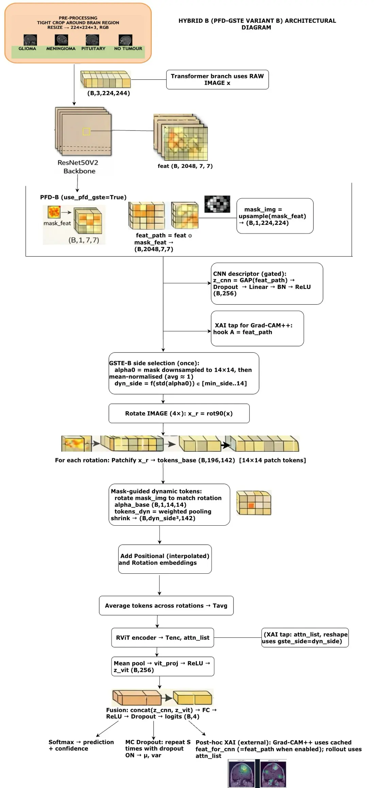
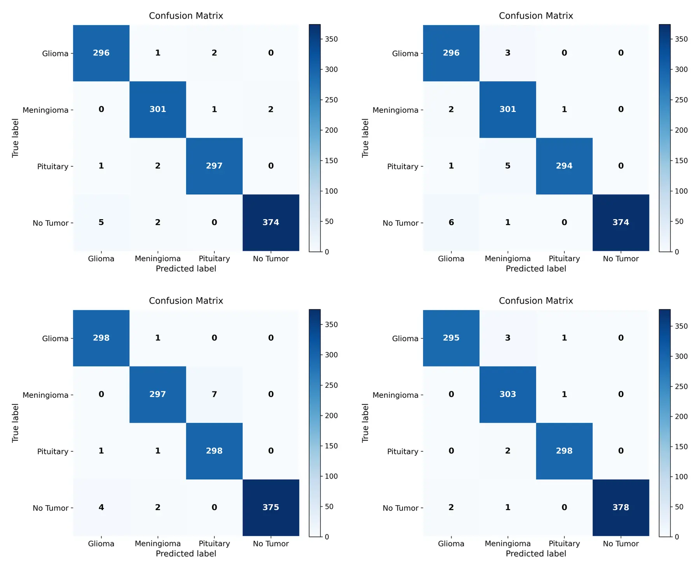

<p align="center">
  
</p>

<h1 align="center">Mitigating Shortcut Learning in Brain Tumour MRI Classification</h1>

<p align="center">
  <strong>An evidence-audited study of pathology-guided ResNet50V2–RViT hybrids</strong><br>
  Riya Basak · BSc (Hons) Computer Science (Artificial Intelligence) · University of Hertfordshire
</p>

<p align="center">
  <a href="https://github.com/AnnyaB/pfd-gste-research-article/actions/workflows/deploy-pages.yml"></a>
  <a href="LICENSE"></a>
  <a href="https://huggingface.co/spaces/tfrere/research-article-template"></a>
  <a href="#research-integrity-and-evidence-boundary"></a>
</p>

<p align="center">
  <a href="https://annyab.github.io/pfd-gste-research-article/"><strong>Read the research article</strong></a>
  ·
  <a href="https://annyab.github.io/pfd-gste-research-article/dataviz/">Explore the visualisations</a>
  ·
  <a href="VALIDATION_PLAN.md">Review the evidence protocol</a>
  ·
  <a href="https://github.com/AnnyaB/HybridResNet50V2-RViT">Inspect the implementation</a>
</p>

---

## Research question

Can learned spatial guidance encourage a hybrid CNN–Transformer to focus on pathology-relevant evidence without sacrificing classification performance—and does that conclusion survive leakage-aware evaluation?

This repository presents the project as a web-native research article built with the official [Hugging Face Research Article Template](https://huggingface.co/spaces/tfrere/research-article-template). It connects the submitted report, implementation, machine-readable results, interactive figures, and an explicit evidence-upgrade protocol in one auditable publication surface.

> [!IMPORTANT]
> **Ablation B is the strongest classifier**, while **Hybrid B shows the strongest Grad-CAM++ localisation among three selected qualitative cases**. The study therefore indicates a classification–localisation trade-off; it does not establish that PFD–GSTE improves accuracy or eliminates shortcut learning.

## What this work contributes

- **Leakage-aware benchmark construction.** Exact SHA-1 deduplication produced 6,726 unique images before the final train/validation/test split.
- **Matched guidance ablations.** Two guided hybrids are compared with their corresponding unguided A- and B-family controls.
- **Branch-specific evidence analysis.** Grad-CAM++ interrogates CNN evidence, Attention Rollout inspects transformer evidence, and MC Dropout probes stochastic predictive behaviour.
- **Auditable results.** Metrics, split counts, qualitative judgements, figures, citations, and limitations are available in machine-readable or directly inspectable form.
- **Predeclared completion gates.** Repeated-seed, calibration, external-validation, and mask-based localisation requirements are specified before any upgraded claim is made.

## Method at a glance

PFD–GSTE is the project’s experimental guidance mechanism:

- **Pathology-Focused Disentanglement (PFD)** learns a one-channel soft spatial gate from CNN features; it does not use manual tumour masks.
- **Guided Semantic Token Evolution (GSTE)** resizes and mean-normalises that gate to guide transformer-facing feature or patch tokens.
- **Late fusion** combines separate CNN and rotation-aware Vision Transformer summaries for four-class prediction.

<p align="center">
  
  
</p>

| Design | Hybrid A | Hybrid B |
| --- | --- | --- |
| Initial transformer tokens | 49 CNN feature tokens | 196 raw-image patch tokens |
| CNN descriptor | Ungated | PFD-gated |
| Guidance reach | Transformer-facing pathway | CNN and transformer pathways |
| Token count | Fixed | Optional concentration-aware pooling |
| Trainable parameters | 26.68M | 26.58M |

Because the A and B designs differ in token source and guidance reach, the defensible causal comparisons are **Hybrid A vs Ablation A** and **Hybrid B vs Ablation B**.

## Verified evaluation

The final evaluation uses 6,726 unique images after exact-duplicate removal.

| Split | Images | Share |
| --- | ---: | ---: |
| Training | 4,353 | 64.72% |
| Validation | 1,089 | 16.19% |
| Held-out test | 1,284 | 19.09% |
| **Total** | **6,726** | **100%** |

### Held-out classification results

| Model | Parameters | Accuracy | Macro-F1 | Test loss | Specificity | Cohen’s κ | MCC | Errors |
| --- | ---: | ---: | ---: | ---: | ---: | ---: | ---: | ---: |
| Hybrid A | 26.68M | 98.75% | 0.9875 | 0.0803 | 0.9959 | 0.9833 | 0.9833 | 16 |
| Hybrid B | 26.58M | 98.52% | 0.9849 | 0.0753 | 0.9952 | 0.9802 | 0.9803 | 19 |
| Ablation A | 26.68M | 98.75% | 0.9873 | 0.0847 | 0.9959 | 0.9833 | 0.9834 | 16 |
| **Ablation B** | **26.58M** | **99.22%** | **0.9920** | **0.0668** | **0.9975** | **0.9896** | **0.9896** | **10** |

Within the B family, Hybrid B trails Ablation B by 0.70 percentage points in accuracy and 0.71 percentage points in macro-F1. This negative ablation result is preserved because it is scientifically more informative than presenting the guided model as the classification winner.

<p align="center">
  
</p>

### Classification and localisation do not select the same model

| Model | Held-out accuracy | Grad-CAM++ judgements marked correct |
| --- | ---: | ---: |
| Hybrid A | 98.75% | 0/3 |
| **Hybrid B** | 98.52% | **3/3** |
| Ablation A | 98.75% | 1/3 |
| **Ablation B** | **99.22%** | 1/3 |

The localisation column records visual judgements for **three selected report cases only**. It is not a full-test-set metric, segmentation score, or proof of causal faithfulness. No tumour masks, Dice scores, IoU scores, or pointing-game results are available.

## Research integrity and evidence boundary

| Question | What is supported now | What remains unestablished |
| --- | --- | --- |
| Classification | One fixed held-out test evaluation for four variants | Repeated-seed uncertainty and confidence intervals |
| Guidance effect | Matched within-family ablations, including the negative B-family result | A general accuracy benefit from PFD–GSTE |
| Localisation | Three qualitative Grad-CAM++/Attention Rollout case studies | Quantitative mask-based localisation or saliency faithfulness |
| Uncertainty | Twenty-pass MC Dropout analysis for selected examples | ECE, Brier score, reliability diagrams, or clinical calibration |
| Generalisation | Internal evaluation after exact SHA-1 deduplication | Patient-level independence, near-duplicate exclusion, and external-cohort validation |
| Clinical use | Research-only four-class modelling | Clinical validity, prospective testing, or medical-device approval |

The forward-looking [Evidence Upgrade Protocol](VALIDATION_PLAN.md) defines five fixed seeds, calibration artefacts, external-cohort eligibility, mask-based localisation metrics, release manifests, and publication gates. A limitation is upgraded only when the corresponding reproducible evidence exists.

> [!CAUTION]
> This is a final-year research project—not a peer-reviewed clinical study, diagnostic service, or medical device. Outputs must not be used for clinical decision-making.

## Research artefacts

| Artefact | Purpose |
| --- | --- |
| [Live research article](https://annyab.github.io/pfd-gste-research-article/) | Full scientific narrative in the Hugging Face article interface |
| [Interactive visualisations](https://annyab.github.io/pfd-gste-research-article/dataviz/) | Model performance, classification–localisation, and uncertainty explorers |
| [Evidence Upgrade Protocol](VALIDATION_PLAN.md) | Predeclared requirements for repeated-seed, calibration, external-validation, and localisation upgrades |
| [Model and experiment repository](https://github.com/AnnyaB/HybridResNet50V2-RViT) | Training, evaluation, interpretability, uncertainty, and package source |
| [Interactive model demo](https://huggingface.co/spaces/AnnyaaB/brain-tumour-pfd-gste-demo) | Research demonstration interface |
| [PFD–GSTE on PyPI](https://pypi.org/project/pfd-gste/) | Installable inference and analysis package |
| [`model-metrics.csv`](app/src/content/assets/data/model-metrics.csv) | Held-out aggregate metrics for all four variants |
| [`split-counts.csv`](app/src/content/assets/data/split-counts.csv) | Final train/validation/test counts |
| [`classification-localisation.csv`](app/src/content/assets/data/classification-localisation.csv) | Explicit scope and counts for the three qualitative cases |
| [`xai-case-audit.csv`](app/src/content/assets/data/xai-case-audit.csv) | Case-level interpretability audit |

## Repository structure

```text
pfd-gste-research-article/
├── .github/workflows/deploy-pages.yml   # Reproducible GitHub Pages deployment
├── app/
│   ├── public/                          # Static figures and report PDF
│   └── src/
│       ├── content/
│       │   ├── article.mdx              # Metadata and chapter order
│       │   ├── chapters/                # Scientific narrative
│       │   ├── embeds/                  # Interactive D3 figures
│       │   ├── assets/data/             # Machine-readable evidence
│       │   └── bibliography.bib         # Referenced literature
│       └── pages/                        # Article and visualisation routes
├── VALIDATION_PLAN.md                   # Evidence-upgrade protocol
└── README.md                            # Research landing page
```

## Reproduce the article locally

Requirements: Node.js 20 or later and npm.

```bash
git clone https://github.com/AnnyaB/pfd-gste-research-article.git
cd pfd-gste-research-article/app
npm ci
npm run dev
```

Validate the production build used for GitHub Pages:

```bash
GITHUB_PAGES=true ASTRO_TELEMETRY_DISABLED=1 npm run build
```

The site is generated as static output in `app/dist/`. Deployment is defined in [`.github/workflows/deploy-pages.yml`](.github/workflows/deploy-pages.yml), so the published article is built from version-controlled source rather than manually uploaded HTML.

## Reproducibility and provenance

- Numerical claims in this README are traceable to the committed CSV evidence tables and submitted report.
- Figures are report-derived assets; interactive plots read committed machine-readable data.
- The article distinguishes reported results from planned validation and labels qualitative evidence at its true sample size.
- Comparative claims are restricted to the evaluated setting; differences in preprocessing, split policy, duplicate handling, and reporting prevent a definitive state-of-the-art claim.
- The implementation repository contains the project citation metadata and model/package documentation.

## Attribution

The publication interface is derived from the official [Hugging Face Research Article Template](https://huggingface.co/spaces/tfrere/research-article-template). Template attribution, repository licences, third-party licences, evidence limitations, and the medical disclaimer must remain intact in redistributed versions.

---
